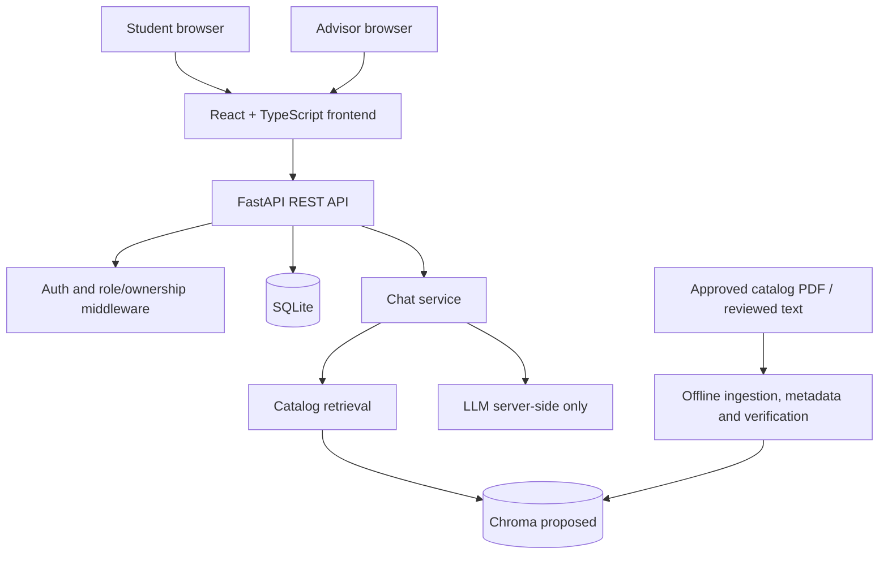
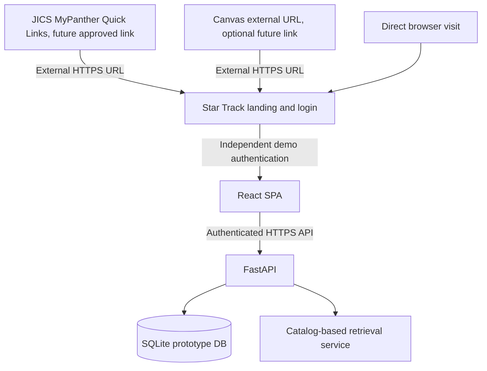

# Star Track: Architecture and API Contract

**Architecture status:** proposed. Inspect repo and team decisions before replacing or extending code.

## Components


## Target code organization
```
frontend/src/
  components/    # shared navigation, buttons, forms, status messages
  pages/         # login, student dashboard, chat, tracker, booking, advisor dashboard
  services/      # typed API client; no server secrets
  types/         # shared frontend DTO types
backend/app/
  main.py        # app bootstrap / CORS
  api/           # auth, chat, programs, progress, booking, advisor routes
  core/          # config, auth, security utilities
  models/        # persistence entities
  schemas/       # Pydantic request/response models
  services/      # app logic and retrieval
  db/            # DB session, migrations, seed script
  rag/           # loader, chunker, vector index, source metadata
backend/tests/   # actual API and service tests
```

Build modules incrementally; this is the **target** layout, not a claim that folders exist today.

## Initial API contracts
All private endpoints require session auth; owner is derived from session, never trusted from a student_id supplied by client. Use consistent JSON errors `{ "detail": "..." }`. Use UTC ISO 8601 timestamps on the wire and display local times clearly.

| Method and route | Role | Request -> Response |
| --- | --- | --- |
| `POST /auth/login` | Public | `{email,password}` -> session cookie and `{id,display_name,role}`; 401 invalid |
| `POST /auth/logout` | Signed in | Invalidate session -> 204 |
| `GET /auth/me` | Signed in | authenticated profile |
| `POST /chat/ask` | Student | `{question}` -> `{status,answer,citations:[{document_title,edition,page,section,excerpt}],source_version}` |
| `GET /programs` | Student | sample programs (one for MVP) |
| `GET /programs/{program_id}/requirements` | Student | requirements with category and catalog version |
| `GET /me/progress` | Student | own requirement IDs, completion states and grouped counts |
| `PUT /me/progress/{requirement_id}` | Student | `{completed:boolean}` -> updated own record, 404 if unknown requirement |
| `GET /advisors/{advisor_id}/slots` | Student | future published available slots |
| `POST /me/bookings` | Student | `{slot_id}` -> booking, 409 if already booked |
| `GET /me/bookings` | Student | own bookings only |
| `PATCH /me/bookings/{booking_id}` | Student | `{new_slot_id}` -> updated booking, 409 conflict |
| `DELETE /me/bookings/{booking_id}` | Student | cancel own booking, 204; 403/404 for unauthorized/unknown |
| `POST /advisor/slots` | Advisor | `{start_at,end_at}` -> new slot; 422 bad time, 409 overlap |
| `GET /advisor/slots` | Advisor | own slots only |
| `GET /advisor/bookings` | Advisor | bookings associated with own slots |
| `GET /health` | Public | existing health check; do not break it |

Exact route names can be refined with team approval and corresponding documentation/tests.

## Authentication and security decisions
- Use a server-side HttpOnly session cookie or a vetted framework equivalent; sessions should be invalidated on logout. In development, set cookies and CORS appropriately for `localhost` ports and use CSRF protection if cookies authenticate mutations. Use HTTPS and Secure cookies for any remote deployment.
- Hash passwords with a modern password hashing algorithm. Never log passwords, raw sessions, model tokens or private questions.
- Enforce role and record ownership on backend endpoints; UI hiding is not security.
- Validate payloads and lengths; rate-limit LLM calls where feasible; never include API secrets in `VITE_*` variables.
- Seed only synthetic users; audit demo data and logs before making the repo public.

## RAG processing
1. Record approved source metadata and a SHA-256 checksum.
2. Extract text with page provenance, manually review representative prerequisite and table sections.
3. Chunk with citations preserved, embed and index offline.
4. On query, retrieve top passages. Check for sufficient relevant support before answering.
5. Prompt LLM to answer only from retrieved text, quote sparingly, cite only known IDs; programmatically map cited IDs to source metadata.
6. If no adequate evidence, return `status: insufficient_evidence` and adviser CTA. Do not make a model invent page citations.
7. Evaluate supported, unsupported and prompt-injection questions with actual expected/actual test logging.

## Booking transaction
- Use a transaction to atomically claim an available slot.
- Enforce a database-level uniqueness rule allowing at most one active booking per slot.
- Rescheduling should verify the new slot before releasing the prior one; keep original booking intact on conflict.
- Reject past slots, malformed timestamps and overlapping windows for one advisor.

## Observability
- Safe error messages to browser, useful development logs without sensitive content.
- Add request trace IDs if inexpensive; do not store questions containing personal details.
- Record measured latency and test results without inventing performance claims.

## Portal-entry architecture and boundaries

The JICS/Canvas integration proposal is a **navigation link**, not a backend integration.



- Keep a documented, stable browser entry path `/` and a login path; support direct loading and refresh of internal application routes in any future hosting configuration (SPA fallback to `index.html`).
- For local development, frontend and API run on separate localhost ports. Any future public demo must use HTTPS, correct frontend/API origin configuration, secure session cookies, CSRF protection where applicable and restricted CORS origins. Never use wildcard credentials CORS.
- A portal link conveys **no identity**. Do not trust `Referer`, query strings, JICS session data or Canvas link parameters as login proof. Do not accept credentials from or transmit them to the portal.
- No JICS/Canvas API calls, SIS integration, OAuth/SSO, LTI launches, portal plugins or iframe embedding are in the MVP. These require separately authorized future work.
- The proposed external Quick Link is configured by a university administrator, outside this repository. Documentation must distinguish a tested standalone URL from a link actually deployed in JICS.
- For public hosting, configure privacy policy/disclaimer and approved branding; never expose synthetic demo passwords for use in a production student environment.

Refer to [PORTAL_INTEGRATION.md](PORTAL_INTEGRATION.md) for acceptance tests and a future university IT handoff checklist.
