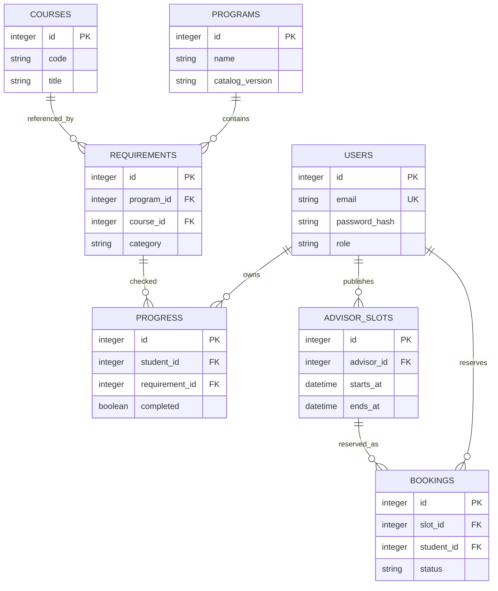

# Star Track: Proposed SQLite Database Schema

This schema supports a **prototype with synthetic data**, not official student records. Use SQLAlchemy models plus Alembic migrations, or equivalent versioned SQL migrations. Do not use `create_all` as a substitute for production migration history once schema work begins.

## ER relationships


## Data dictionary
| Table | Fields and constraints |
| --- | --- |
| `users` | `id` PK, `email` UNIQUE NOT NULL, `display_name`, `password_hash` NOT NULL, `role` CHECK IN (`student`,`advisor`), `created_at`. |
| `programs` | `id` PK, `name`, `catalog_version`, `is_sample` BOOLEAN DEFAULT 1. |
| `courses` | `id` PK, `code`, `title`, `description` nullable, `catalog_version`; UNIQUE(`code`,`catalog_version`). |
| `requirements` | `id` PK, `program_id` FK, `course_id` FK, `category` CHECK IN (`general_education`,`major_core`,`electives`); UNIQUE(`program_id`,`course_id`) for fixed-checklist MVP. |
| `progress` | `id` PK, `student_id` FK users, `requirement_id` FK requirements, `completed` BOOLEAN, `updated_at`; UNIQUE(`student_id`,`requirement_id`). |
| `advisor_slots` | `id` PK, `advisor_id` FK users, `starts_at`, `ends_at`, `is_published` BOOLEAN; CHECK(`ends_at` > `starts_at`). Enforce no overlaps for one advisor in transactional code. |
| `bookings` | `id` PK, `slot_id` FK advisor_slots, `student_id` FK users, `status` CHECK IN (`booked`,`canceled`), `created_at`, `updated_at`; partial UNIQUE index on `slot_id` WHERE `status = 'booked'`. |
| `catalog_documents` | `id` PK, `title`, `edition`, `checksum_sha256` UNIQUE, `source_filename`, `imported_at`, `approved_for_demo` BOOLEAN. |
| `catalog_chunks` | `id` PK, `document_id` FK, `vector_id` UNIQUE, `page_number` nullable, `section_title` nullable, `text_excerpt`; store only approved content. |

## Key constraints and implementation rules
```sql
CREATE UNIQUE INDEX IF NOT EXISTS uq_active_booking_per_slot
ON bookings(slot_id)
WHERE status = 'booked';
```
- Apply foreign keys with `PRAGMA foreign_keys = ON` for each SQLite connection.
- Every booking mutation must occur inside a transaction; handle unique-index violations by returning HTTP 409.
- `advisor_slots.advisor_id` must reference an advisor user; `progress.student_id` and `bookings.student_id` must reference students. Validate at application level and test.
- Store all timestamps in UTC, return ISO 8601 values and format in UI with timezone context.
- **Do not store a total progress percentage** as a separate authoritative field. Derive it from requirements and self-reported progress.
- Requirement counts assume a fixed checklist. Advanced elective-choice logic is out of scope.
- For demo: seed two synthetic students, one synthetic advisor, an approved sample checklist, and several future slots. No real credentials or real personal records.

## Migration order
1. users / programs / courses
2. requirements / progress
3. advisor_slots / bookings + partial unique index
4. catalog_documents / catalog_chunks
5. development-only synthetic seed script

Keep schema revisions synchronized with `ARCHITECTURE.md` and tests.
